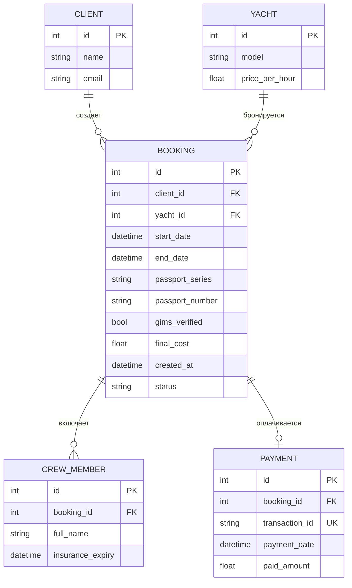
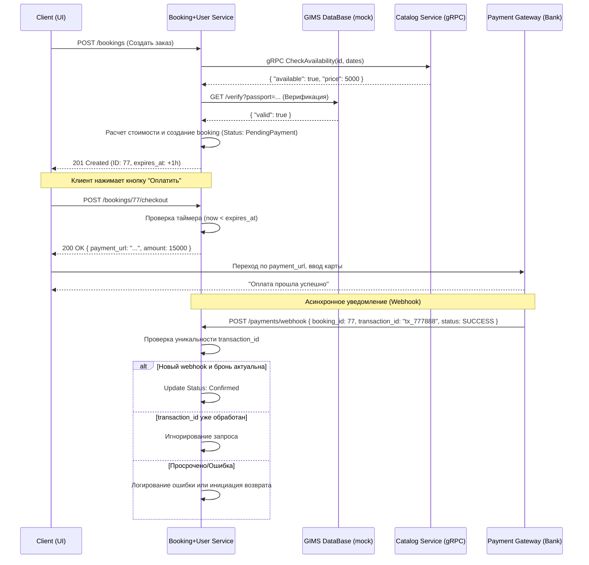

# Финальный проект: Yacht Sharing Pro

# Этап 1: Проектирование доменной области

## 1. Описание предметной области
**Бизнес-контекст:** Система «Yacht Sharing Pro» — это цифровая платформа для аренды парусных и моторных яхт для опытных любителей и профессионалов с наличием морских прав. Проект решает проблему доступности яхтенного спорта, позволяя пользователям без собственного судна выходить на воду в различные акватории. Доступ к бронированию предоставляется только после успешной автоматизированной проверки лицензии шкипера через реестр ГИМС МЧС и предоставления страховок на всех участников похода.

## 2. Основные сценарии использования (Use Cases)

### UC-1: Регистрация клиента
* **Актор:** Клиент.
* **Поток:** Клиент отправляет свои имя и email. Система проверяет уникальность данных в репозитории. Если такой email уже зарегистрирован, система возвращает существующий ID клиента для сквозной авторизации. Если клиент новый — создает запись в базе данных.

### UC-2: Бронирование яхты и расчет стоимости
* **Актор:** Клиент.
* **Поток:** Клиент выбирает интервал времени и яхту. Система проверяет наличие лицензии по введенным паспортным данным. Если лицензии нет — бронирование запрещено. Система рассчитывает стоимость и проверяет попадание в рабочие часы (10:00–21:00).

### UC-3: Загрузка документов экипажа
* **Актор:** Клиент.
* **Поток:** Для завершения бронирования клиент вручную вводит сроки действия страховок на каждого члена экипажа, вводит серию и номер паспорта для проверки наличия актуальной лицензии. Система блокирует создание, если введенная дата истечения страховки раньше даты окончания аренды или если не найдена лицензия.

### UC-4: Оплата заказа
* **Актор:** Клиент, Система.
* **Поток:** После создания бронирования клиент совершает платеж. При успехе статус меняется с `PendingPayment` на `Confirmed`.

### UC-5: Отмена бронирования
* **Актор:** Клиент.
* **Поток:** Клиент может отменить бронь. Если бронь оплачена и до начала аренды более 24 часов, система переводит заказ в статус `Cancelled` и выставляет признак доступности возврата средств `IsRefundEligible = true`. Если до начала аренды менее 24 часов, заказ отменяется без возврата средств (`IsRefundEligible = false`). Если бронь не оплачена — статус просто меняется на `Cancelled`.

### UC-6: Проверка доступности ресурсов
* **Актор:** Система.
* **Поток:** Автоматическая фильтрация яхт, исключающая пересечения графиков.

### UC-7: Верификация лицензии в МЧС
* **Актор:** Система.
* **Поток:** Система обращается к мокированному REST-сервису, работающему поверх локальной базы валидных паспортных данных. При вводе данных отправляется запрос с серией и номером паспорта рулевого. Если ответ — «Действителен», бронирование разрешается. Если «Не найден», система возвращает ошибку.

## 3. Бизнес-правила и ограничения
1. **Минимальный заказ:** Бронирование невозможно на срок менее 1 часа.
2. **Время брони:** Бронь без оплаты актуальна в течение часа. Если не оплатить заказ за это время, бронь аннулируется фоновым шедулером, переводя заказ в статус `Expired`.
3. **Профессиональный допуск:** Аренда возможна только при наличии действующей лицензии шкипера.
4. **Верификация:** Для подтверждения права управления судном система проводит автоматическую сверку паспортных данных шкипера с локальным мокированным реестром ГИМС МЧС.
5. **Страховой регламент:** Каждый член экипажа (включая шкипера) должен иметь действующую страховку на период плавания.
6. **Загрузка документов:** Данные о документах вводятся заново для каждого заказа для обеспечения актуальности и безопасности. Паспортные данные сохраняются только в рамках активного бронирования.
7. **Финансовая политика:** 100% предоплата. Сумма `paid_amount` в оплате фиксируется на момент создания заказа.
8. **Уникальность ресурсов:** Исключение "овербукинга" — одна яхта на один интервал времени.
9. **Рабочий день клуба:** С 10:00 до 21:00. Последний возможный старт аренды — 20:00, окончание – строго до 21:00.
10. **Идемпотентность платежей:** Повторная обработка webhook с одинаковым `transaction_id` запрещена. Если уведомление уже было обработано, система игнорирует запрос.

## 4. Описание доменных моделей (Сущности)
* **Client (Пользователь):** Имя, контактные данные (почта).
* **Yacht (Продукт):** Модель судна и почасовая стоимость.
* **Booking (Заказ):** Агрегатор. Хранит даты, итоговую стоимость, комплексный тип `Passport` шкипера, забронированную яхту, время создания и статус.
* **Crew_Member (Страховки):** Таблица, где каждая строка — это ФИО члена экипажа и дата окончания его страховки. Связана с `Booking` (один ко многим).
* **Payment (Платеж)**: Данные подтвержденной транзакции (дата, сумма, transaction_id).

## 5. ER-диаграмма


## 6. Нефункциональные требования
1. Время ответа API — не более 2 секунд.
2. Система должна поддерживать не менее 50 одновременных запросов.
3. Проверка лицензии должна выполняться не более чем за 1 секунду.
4. Время поиска доступных яхт — не более 300 мс.

# Этап 2: Проектирование API и контрактов

## 1. Архитектурный стиль и сервисная декомпозиция

1. **Booking+User Service** (основной сервис):
   - Управление учетными данными клиентов (регистрация, профиль)
   - Бизнес-логика бронирования (создание, оплата, отмена)
   - Верификация лицензии в ГИМС МЧС
   - Управление экипажем и страховками
   - Контроль таймера оплаты (фоновая задача)

2. **Catalog Service** (read-optimized сервис):
   - Хранение информации о яхтах (модель, цена)
   - Проверка доступности яхты на интервал
   - Поиск свободных яхт (фильтрация по датам)

> Архитектура разделена по принципу ответственности: 
> - *Catalog* управляет инвентарём и отвечает за быстрые read-запросы
> - *Booking+User* инкапсулирует всю бизнес-логику и состояние заказов

## 2. Протоколы взаимодействия
* **REST (HTTP/JSON)**:
  
  Основной протокол для Front-end ↔ Back-end.

  Обработка асинхронных уведомлений от платежного шлюза (имитация банковского ответа).
* **gRPC (HTTP/2 / Protobuf)**:
  
  Только для внутреннего вызова *Booking+User* → *Catalog* (проверка доступности яхты и получение цены).
* **External REST API**:

  GET-запрос к мокированному реестру ГИМС МЧС.

  Исходящие запросы к эмулятору банка для инициации платежных сессий.

### 2.1 Спецификация API (REST)

#### 2.1.1 Регистрация клиента
**POST** `/api/v1/clients`
*   **Описание**: Принимает имя и email клиента. Если email уже зарегистрирован, возвращает существующий ID клиента. Если новый — создает запись и возвращает ID.
*   **Request DTO (JSON)**:
```json
{
  "name": "Иван Иванов",
  "email": "ivan@example.com"
}
```
*   **Response DTO (JSON)**:
```json
{
  "clientId": 105
}
```

#### 2.1.2 Создание бронирования
**POST** `/api/v1/bookings`
*   **Описание**: Принимает ID клиента и яхты, паспортные данные шкипера для верификации и список экипажа. Автоматически добавляет клиента в список экипажа и инициирует проверку в ГИМС МЧС. Клиенту не нужно включать шкипера (себя) в массив `crew` — система сделает это самостоятельно (бронирование будет в виде формы с полями под каждого участника). 
*   **Request DTO (JSON)**:
```json
{
  "clientId": 105,
  "yachtId": 7,
  "startDate": "2024-06-20T10:00:00Z",
  "endDate": "2024-06-20T14:00:00Z",
  "passport": {
    "series": 4512,
    "number": 123456
  },
  "crew": [
    {
      "fullName": "Петр Петров",
      "insuranceExpiry": "2024-12-31T23:59:59Z"
    }
  ]
}
```

* **Response DTO (JSON)**:
```json
{
  "bookingId": "05b733d0-8a98-4730-8e1e-1bb45ba2e0b1",
  "status": 0,
  "finalCost": 15000,
  "expiresAt": "2024-06-20T11:00:00Z"
}
```

#### 2.1.3 Инициация оплаты (создание платежной сессии)
**POST** `/api/v1/bookings/{id}/checkout`
*   **Описание**: Генерирует ссылку на оплату. Система проверяет время создания брони: если прошло больше часа, возвращает 408 REQUEST_TIMEOUT и переводит бронь в статус Expired. Если всё в порядке, возвращается URL для перехода к оплате. Сумма фиксируется сервером и не может быть изменена клиентом.
*   **Response DTO (JSON)**:
```json
{
  "bookingId": "05b733d0-8a98-4730-8e1e-1bb45ba2e0b1",
  "amount": 22500.00,
  "paymentUrl": "[https://yacht-pay.mock/session/05b733d0-8a98-4730-8e1e-1bb45ba2e0b1](https://yacht-pay.mock/session/05b733d0-8a98-4730-8e1e-1bb45ba2e0b1)",
  "transactionId": "tx_fa98d28a38104dbfa2197",
  "expirationTime": "2026-06-23T16:25:57.225911Z"
}
```

#### 2.1.4 Обработка платежного уведомления (Webhook)
**POST** `/api/v1/payments/webhook`
*   **Описание**: Имитация Callback-уведомления от внешнего платежного шлюза. Принимает данные о результате транзакции. Если status: "SUCCESS", бронирование переходит в статус Confirmed. В реальной системе этот эндпоинт защищен цифровой подписью банка. Поле `transaction_id` генерируется внешним платежным шлюзом в момент обработки платежа и используется системой для аудита и предотвращения повторной обработки webhook.
*   **Request DTO (JSON)**:
```json
{
  "bookingId": "05b733d0-8a98-4730-8e1e-1bb45ba2e0b1",
  "transactionId": "tx_fa98d28a38104dbfa2197",
  "status": 0,
  "amount": 15000
}
```

#### 2.1.5 Отмена бронирования
**POST** `/api/v1/bookings/{id}/cancel`
*   **Описание**: Переводит бронирование в статус `Cancelled`.
*   **Response**: `204 No Content`.


#### 2.1.5 Получение информации о бронировании
**GET** `/api/v1/bookings/{id}`

*   **Response DTO (JSON)** для активной брони:
```json
{
"bookingId": "05b733d0-8a98-4730-8e1e-1bb45ba2e0b1",
"status": 1,
"finalCost": 22500,
"expiresAt": "2026-06-23T16:25:57.225911Z"
}
```
        
*   **Response DTO (JSON)** после выполнения отмены (динамическое появление флага):
```json
{
"bookingId": "05b733d0-8a98-4730-8e1e-1bb45ba2e0b1",
"status": 3,
"finalCost": 22500,
"expiresAt": "2026-06-23T16:25:57.225911Z",
"isRefundEligible": true
}
```

#### 2.1.7 Поиск доступных яхт
**GET** `/api/v1/yachts/available?start=...&end=...`
*   **Описание**: Возвращает список объектов `Yacht`, свободных в указанный интервал.

#### 2.1.8 Health Check
**GET** `/health`

*   **Описание**: Возвращает статус работоспособности сервиса. 
    Используется для мониторинга и оркестрации.
    *Каждый сервис предоставляет собственный endpoint `/health`.*

*   **Примеры ответов**:

**Booking+User Service**:
```json
{
  "service": "booking-user",
  "status": "ok",
  "timestamp": "2024-06-20T14:30:00Z",
  "checks": {
    "database": "connected",
    "gims_mock": "reachable",
    "scheduler": "running"
  }
}
```

**Catalog Service**:
```json
{
  "service": "catalog",
  "status": "ok",
  "timestamp": "2024-06-20T14:30:00Z",
  "checks": {
    "database": "connected"
  }
}
```
---

### 2.2 Протокол взаимодействия gRPC (Internal API)
Используется для сверхбыстрого взаимодействия между **Booking+User Service** и **Catalog Service**. Это позволяет мгновенно проверять статус яхты и её актуальную стоимость без накладных расходов JSON-сериализации.

#### 2.2.1 Контракт `catalog.proto`
```protobuf
syntax = "proto3";

package catalog;

service Catalog {
  rpc CheckYachtAvailability(AvailabilityRequest) returns (AvailabilityResponse);
  rpc GetYachtInfo(YachtRequest) returns (YachtResponse);
  rpc RegisterBookingProjection (RegisterBookingRequest) returns (RegisterBookingResponse);
}

message AvailabilityRequest {
  int32 yacht_id = 1;
  string start_time = 2; // ISO 8601
  string end_time = 3;   // ISO 8601
}

message AvailabilityResponse {
  bool is_available = 1;
  double price_per_hour = 2;
  string currency = 3;
}

message YachtRequest {
  int32 yacht_id = 1;
}

message YachtResponse {
  int32 id = 1;
  string model = 2;
  double price_per_hour = 3;
}

message RegisterBookingRequest {
  int32 yacht_id = 1;
  string start_time = 2;
  string end_time = 3;
}

message RegisterBookingResponse {
  bool is_success = 1;
}
```


## 3. Схемы данных (DTO) в OpenAPI (Swagger)
Здесь описаны все сущности системы для обеспечения единообразия обмена данными.

```yaml
components:
  schemas:
    Yacht:
      type: object
      properties:
        id: { type: integer }
        model: { type: string }
        price_per_hour: { type: number }

    RegisterClientDto:
      type: object
      required: [name, email]
      properties:
        name: { type: string }
        email: { type: string, format: email }
        
    BookingRequest:
      type: object
      required: [client_id, yacht_id, start_date, end_date, passport]
      properties:
        client_id: { type: string, format: uuid }
        yacht_id: { type: integer }
        start_date: { type: string, format: date-time }
        end_date: { type: string, format: date-time }
        passport:
          type: object
          properties:
            series: { type: string, example: "4512" }
            number: { type: string, example: "123456" }
        crew:
          type: array
          items:
            $ref: '#/components/schemas/CrewMember'

    PaymentSessionResponse:
      type: object
      properties:
        bookingId: { type: string, format: uuid }
        amount: { type: number }
        paymentUrl: { type: string, format: uri }
        transactionId: { type: string }
        expirationTime: { type: string, format: date-time }

    CrewMember:
      type: object
      properties:
        full_name: { type: string }
        insurance_expiry: { type: string, format: date-time }

    PaymentWebhook:
      type: object
      required: [bookingId, transactionId, status, amount]
      properties:
        bookingId: { type: string, format: uuid }
        transactionId: { type: string }
        status: { type: integer, enum: [0, 1], description: "0 = Success, 1 = Failed" }
        amount: { type: number }
        
    BookingResponse:
      type: object
      properties:
        bookingId: { type: string, format: uuid }
        status: { type: integer, enum: [0, 1, 2, 3], description: "0=PendingPayment, 1=Confirmed, 2=Expired, 3=Cancelled" }
        final_cost: { type: number }
        expires_at: { type: string, format: date-time }
        isRefundEligible: { type: boolean, nullable: true }
```

## 4. Обработка ошибок (Error Codes)
*   `400 INVALID_WORKING_HOURS`: Выход за пределы интервала 10:00–21:00 (старт не ранее 10:00, финиш не позднее 21:00).
*   `400 INSURANCE_EXPIRED`: Срок страховки члена экипажа истекает раньше даты `end_date` аренды.
*   `409 PAYMENT_RECONCILIATION_FAILED`: Сумма подтвержденного платежа не совпадает с ожидаемой стоимостью бронирования.
*   `403 MCHS_VERIFICATION_FAILED`: Паспортные данные не найдены или лицензия недействительна в реестре ГИМС.
*   `408 REQUEST_TIMEOUT`: Срок оплаты бронирования (1 час с момента создания) истек, бронь аннулирована.

## 5. Sequence Diagram (Логика верификации и оплаты)


